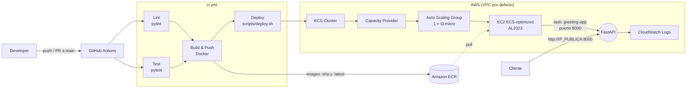
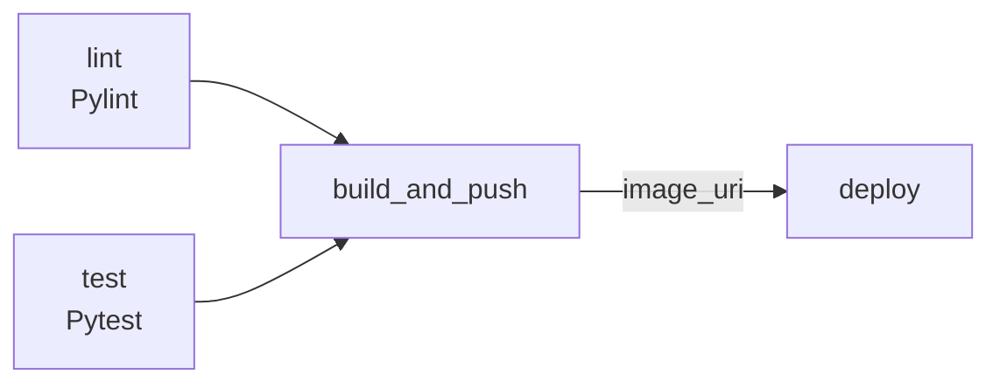
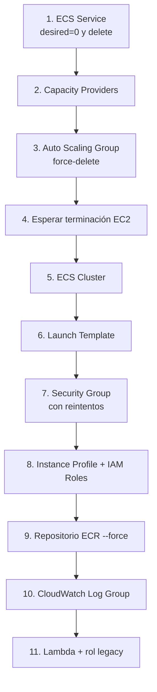

# Greeting API — DevOps Lab 1 (CI/CD)


Backend en **Python + FastAPI** que devuelve un saludo personalizado. El objetivo real del proyecto no es la API en sí, sino implementar **dos flujos de trabajo de GitHub Actions** sobre AWS:

| Workflow | Archivo | Propósito |
|---|---|---|
| **CI/CD Pipeline** | `.github/workflows/ci.yml` | Lint → Tests → Build & Push de la imagen a ECR → Deploy a ECS sobre EC2 |
| **Cleanup (Destroy)** | `.github/workflows/cleanup-student-infrastructure.yml` | Elimina toda la infraestructura AWS creada para un `STUDENT_SUFFIX` |

Todos los recursos AWS se nombran y etiquetan con un **`STUDENT_SUFFIX`**, lo que permite que varias personas desplieguen en la misma cuenta sin colisiones y que el destroy limpie exactamente lo que le pertenece a cada una.

---

## Tabla de contenido

- [Arquitectura](#arquitectura)
- [Estructura del proyecto](#estructura-del-proyecto)
- [API](#api)
- [Desarrollo local](#desarrollo-local)
- [Docker](#docker)
- [Workflow 1: CI/CD](#workflow-1-cicd)
- [Workflow 2: Destroy](#workflow-2-destroy)
- [Configuración de GitHub](#configuración-de-github)
- [Recursos AWS creados](#recursos-aws-creados)
- [Ejecución manual de los scripts](#ejecución-manual-de-los-scripts)
- [Troubleshooting](#troubleshooting)

---

## Arquitectura



**Stack:** Python 3.12 · FastAPI · Uvicorn · Poetry · Pylint · Pytest · Docker · AWS CLI · ECR · ECS (EC2 launch type, red `bridge`) · Auto Scaling · IAM · CloudWatch Logs.

---

## Estructura del proyecto

```text
devops-lab-1-cicd/
├── .github/workflows/
│   ├── ci.yml                                # Pipeline CI/CD
│   └── cleanup-student-infrastructure.yml    # Pipeline de destroy (manual)
├── scripts/
│   ├── deploy.sh                             # Aprovisiona/actualiza la infraestructura (idempotente)
│   └── destroy.sh                            # Elimina la infraestructura de un STUDENT_SUFFIX
├── src/
│   ├── main.py                               # App FastAPI (lo que se despliega)
│   └── function_greeting/main.py             # Handler Lambda (versión legacy del lab)
├── tests/
│   └── test_greeting.py                      # Tests unitarios con TestClient
├── docs/
├── Dockerfile
├── .dockerignore
├── pyproject.toml                            # Dependencias y configuración (Poetry)
└── poetry.lock
```

> `src/function_greeting/` contiene la implementación anterior basada en AWS Lambda. Ya no se despliega, pero `destroy.sh` sigue limpiando la Lambda y su rol si existieran de iteraciones previas.

---

## API

Documentación interactiva generada por FastAPI:

- Swagger UI: `http://<host>:8000/docs`
- ReDoc: `http://<host>:8000/redoc`

### `GET /`

Devuelve un saludo. Si se envían `first_name` **y** `last_name`, el saludo es personalizado.

| Parámetro | Tipo | Requerido | Descripción |
|---|---|---|---|
| `first_name` | query `string` | No | Nombre |
| `last_name` | query `string` | No | Apellido |

```bash
curl "http://localhost:8000/?first_name=John&last_name=Doe"
# {"message": "Hello, John Doe!"}

curl "http://localhost:8000/"
# {"message": "Hello, World! Please provide your first name and last name as query parameters."}
```

### `GET /health`

Health check para ECS y monitoreo del contenedor.

```bash
curl http://localhost:8000/health
# {"status": "healthy"}
```

---

## Desarrollo local

### Requisitos

- Python **3.12+**
- [Poetry](https://python-poetry.org/docs/#installation)

### Instalación

```bash
git clone <url-del-repo>
cd devops-lab-1-cicd
poetry install          # instala dependencias de main + grupo dev
```

### Ejecutar la API

```bash
poetry run uvicorn main:app --app-dir src --reload --port 8000
```

### Lint y tests (lo mismo que corre el CI)

```bash
poetry run pylint src
poetry run pytest tests -vv
```

> Los tests importan `from main import app`. Funciona porque `poetry install` instala `src/main.py` como paquete (ver `packages` en `pyproject.toml`). Si corres pytest fuera de Poetry, usa `PYTHONPATH=src pytest tests`.

---

## Docker

```bash
docker build -t greeting-app .
docker run --rm -p 8000:8000 greeting-app
```

La imagen se basa en `python:3.12-slim`, instala solo las dependencias de producción (`poetry install --only main`) y arranca Uvicorn en `0.0.0.0:8000`. El `.dockerignore` excluye tests, docs, `.git`, `.github` y archivos `.env*`.

---

## Workflow 1: CI/CD

**Archivo:** `.github/workflows/ci.yml`

### Disparadores

| Evento | Jobs que se ejecutan |
|---|---|
| `pull_request` a `main` | `lint`, `test` (solo validación, **no despliega**) |
| `push` a `main` | `lint`, `test`, `build_and_push`, `deploy` |
| `workflow_dispatch` (manual) | Todos. Acepta un input opcional `student_suffix` |

### Jobs



1. **`lint`** — Instala dependencias con Poetry y ejecuta `pylint src`.
2. **`test`** — Ejecuta `pytest tests -vv`. Corre en paralelo con `lint`.
3. **`build_and_push`** — Requiere que `lint` y `test` pasen.
   - Configura credenciales AWS y hace login en ECR.
   - Crea el repositorio ECR `greeting-<STUDENT_SUFFIX>` si no existe.
   - Construye la imagen con dos tags: `<git-sha>` (inmutable, trazable) y `latest`.
   - Publica la `image_uri` (con el SHA) como output del job.
4. **`deploy`** — Ejecuta `scripts/deploy.sh` con la `IMAGE_URI` del paso anterior. El script es **idempotente**: crea lo que falta y actualiza lo que ya existe, así que cada push a `main` registra una nueva revisión de la task definition y fuerza un nuevo despliegue del servicio.

Al terminar, los logs del job `deploy` muestran la URL pública:

```text
EC2 Instance Public IP: 3.91.x.x
App URL: http://3.91.x.x:8000/
Health Check: http://3.91.x.x:8000/health
Personalized Greeting: http://3.91.x.x:8000/?first_name=John&last_name=Doe
```

> En el primer despliegue la instancia puede tardar un par de minutos en registrarse en el cluster y arrancar la task. Si la IP aparece como *pending*, revisa la consola de EC2/ECS.

---

## Workflow 2: Destroy

**Archivo:** `.github/workflows/cleanup-student-infrastructure.yml`

Se ejecuta **solo manualmente** (`workflow_dispatch`) y requiere el input obligatorio `student_suffix`.

### Cómo ejecutarlo

1. Ir a **Actions → Cleanup Student Infrastructure → Run workflow**.
2. Escribir el `student_suffix` usado en el despliegue.
3. Ejecutar.

### Pasos

1. Configura credenciales AWS.
2. **Valida el suffix**: no vacío y solo `[a-zA-Z0-9_-]`. Evita ejecuciones accidentales o inyección en nombres de recursos.
3. Verifica la identidad con `aws sts get-caller-identity`.
4. Ejecuta `scripts/destroy.sh <student_suffix>`.

### Orden de eliminación

El orden respeta las dependencias entre recursos (no se puede borrar un cluster con servicios activos ni un security group con interfaces de red adjuntas):



Cada paso verifica primero si el recurso existe y tolera errores (`|| true`), por lo que el destroy se puede **ejecutar varias veces sin fallar**, incluso si un despliegue quedó a medias.

> ⚠️ El repositorio ECR se elimina con `--force`, es decir, **se borran todas las imágenes**. No es reversible.

---

## Configuración de GitHub

En **Settings → Secrets and variables → Actions**:

### Secrets

| Nombre | Descripción |
|---|---|
| `AWS_ACCESS_KEY_ID` | Access key del usuario IAM que ejecuta los pipelines |
| `AWS_SECRET_ACCESS_KEY` | Secret key correspondiente |

### Variables

| Nombre | Requerida | Default | Descripción |
|---|---|---|---|
| `STUDENT_SUFFIX` | Sí (para `push`) | — | Identificador único, se recomienda el username IAM. Se puede sobrescribir con el input de `workflow_dispatch` |
| `AWS_REGION` | No | `us-east-1` | Región de despliegue |

### Permisos IAM necesarios

El usuario IAM debe poder operar sobre: **ECR, ECS, EC2** (VPC, subnets, security groups, launch templates, instancias), **Auto Scaling**, **IAM** (crear roles e instance profiles, `iam:PassRole`), **SSM** (`ssm:GetParameter` para resolver la AMI), **CloudWatch Logs** y **STS**. Para destroy además **Lambda** (limpieza legacy).


## Autor

Luis Carlos Rodríguez — Laboratorio 1 de DevOps (CI/CD).
